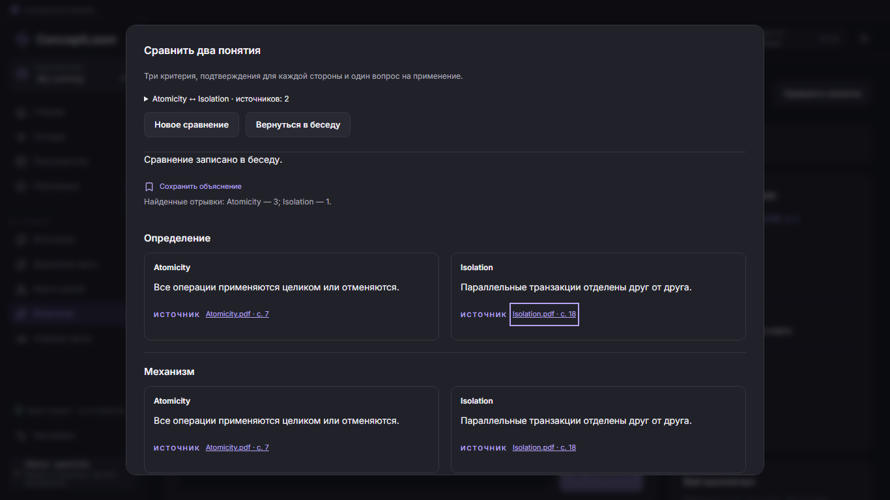

<p align="center">
  
</p>

# Concept Loom

[English](#concept-loom) · [Русский](docs/ru/README.md)

## ConceptLoom Desktop 0.3.7

A Windows learning app built with React, Tauri and SQLite: import your own
materials, build a map of concepts, study one connection at a time, check your
understanding and review flashcards with FSRS. The CAPYBARA interface includes
independent workspaces, libraries, Today, Roadmap, Study Hub and light/dark themes.

Run AI locally with Ollama (`qwen3:4b` by default), or use the app's account-client
connections for ChatGPT, Claude or Gemini. Account connections require internet,
explicit consent and access accepted by the relevant official client. An account
or subscription does not guarantee every model. See [AI setup and privacy](docs/account-providers.md).

**Branch status checked 27 October 2026:** this documentation describes the
implemented **0.3.7 development line**. GitHub's default `main` still contains
Desktop **0.1.1**. The complete P1–P6 code is on
[`codex/p6-source-comparison`](https://github.com/AtaAiti/ConceptLoom-Desktop/tree/codex/p6-source-comparison),
with [PR #10](https://github.com/AtaAiti/ConceptLoom-Desktop/pull/10) stacked on the
preceding feature PRs. These features are not yet merged into `main`.

### What you can do

- Import PDF, TXT, Markdown or pasted text and search saved passages locally.
- **P1 — read with a tutor:** open a page or citation, choose a precise fragment
  and send an editable question with that source context.
- **P2 — save explanations:** bookmark tutor replies in Study Hub, retaining their
  citations for later reading.
- **P3 — ask about the map:** start a tutor question from a selected concept and
  its prerequisites.
- **P4 — practise a passage:** generate two draft flashcards, edit/select them,
  then explicitly add them to FSRS review.
- **P5 — inspect a section:** request three points, three terms and three questions
  for 1–5 selected pages. The cached guide states its coverage and flags changed text.
- **P6 — compare concepts:** compare two concepts across three criteria with
  citations for each supported side and explicit missing evidence. Save the result
  in the conversation or bookmark it.

Reading, generated explanations and comparisons do not count as mastery evidence.
See [P1–P6 scope and implementation notes](docs/notebooklm-product-review.md).



*Source comparison screen with synthetic demonstration materials. The
[desktop guide](desktop/README.md) covers setup, limits and verification.*

### Start the current desktop development version

Install the [Windows build prerequisites](desktop/README.md#windows-requirements),
then use the implemented feature branch rather than the older default branch:

```powershell
git clone --branch codex/p6-source-comparison https://github.com/AtaAiti/ConceptLoom-Desktop.git
cd ConceptLoom-Desktop/desktop
npm ci
npm run desktop
```

For local AI, install Ollama separately and download `qwen3:4b` once with
`ollama pull qwen3:4b`. The app also offers the account-client path in Settings.
Browser preview and the installed Windows app use separate storage; account
connections require the Windows app.

Build a Windows installer with `npm run package` from `desktop`. The NSIS output
is under `desktop/src-tauri/target/release/bundle/nsis/`. Local copies in
`desktop/releases/` are Git-ignored build artifacts, not source-controlled downloads.

## Original MCP workflow — 1.1.0

**A portable AI learning workflow for Codex, Claude Code, OpenCode, and DeepSeek Harness.**

MCP package version 1.1.0 · MIT licensed · Node.js 20+. The MCP package and Desktop
have separate versions, setup commands and storage. The workflow below runs inside
a coding client; it is not required to launch the desktop app.

Concept Loom turns a coding agent into a structured learning partner. Instead of immediately producing a long explanation, it helps you define a useful goal, finds the edge of your current understanding, proposes a short dependency path, and teaches one connection at a time.

```text
goal → knowledge frontier → learning map → one connection → check → transfer
```

It works with topics you explore from scratch and with your own books, courses, notes, code, and transcripts.

### Why use it?

- Learn toward a practical outcome instead of surveying an entire field.
- Expose gaps and misconceptions before building on them.
- Check understanding with concealed-answer checkpoints.
- Measure recognition, recall, application, and transfer separately.
- Revisit due concepts through spaced retrieval across sessions.
- Keep concise Markdown learning notes between sessions.
- Use the same workflow in Codex, Claude Code, OpenCode, and DeepSeek Harness.
- Show compact text or Mermaid diagrams directly in the conversation.

### Documentation

| Guide | Use it when… |
|---|---|
| [How Concept Loom works](docs/en/how-it-works.md) | You want to understand the method and architecture. |
| [Learning from scratch](docs/en/learning-from-scratch.md) | You are starting without a book or course. |
| [Learning with source materials](docs/en/learning-with-source-materials.md) | You have PDFs, EPUBs, notes, videos, code, or course files. |

Russian documentation starts at [docs/ru/README.md](docs/ru/README.md).

### Quick start with Codex

Requirements: Node.js 20+ and Codex CLI.

```bash
# Install the adapter and register its MCP server automatically
node scripts/setup.mjs codex --target /path/to/learning-workspace

# Start learning
cd /path/to/learning-workspace
codex
```

Use `--skip-mcp` only if you want to install the workspace files without changing the global Codex MCP configuration.

After updating Concept Loom, refresh an already installed skill with `node scripts/setup.mjs codex --target /path/to/learning-workspace --refresh`.

Then ask:

```text
Use $concept-coach. I want to understand database transactions well enough
to choose the right isolation level for a small web application.
```

### Other clients

```bash
node scripts/setup.mjs claude-code --target /path/to/learning-workspace
node scripts/setup.mjs opencode --target /path/to/learning-workspace
node scripts/setup.mjs deepseek-harness --target /path/to/learning-workspace
```

DeepSeek Harness support uses its native project skill directory and an MCP patch. Start it from the learning workspace with:

```bash
npx @deepseek-ai/dsh --profile web --patch .dsh/concept-loom.patch.yml
```

DeepSeek Harness is currently a developer preview and may introduce breaking configuration changes. Use `--skip-mcp` if you only want the `.dsh/skills/concept-coach` skill and will connect the MCP server through your own Harness profile.

Initial installation refuses to overwrite existing configuration and may generate
fallback guidance to merge manually. `--refresh` updates the managed skill files
(and the DeepSeek Harness patch); it does not replace all workspace configuration.

The original MCP package has no runtime npm dependencies. Small structures are displayed as monospace text diagrams; larger relationship maps are returned as Mermaid blocks that remain readable in the terminal and render in compatible Markdown viewers.

### Verify the original MCP package

```bash
npm test
npm run check
```

Run these commands from the repository root. Desktop checks are separate; see
[desktop verification](desktop/README.md#verification).

## License

MIT. Security reports: [SECURITY.md](SECURITY.md). Release history: [CHANGELOG.md](CHANGELOG.md).
